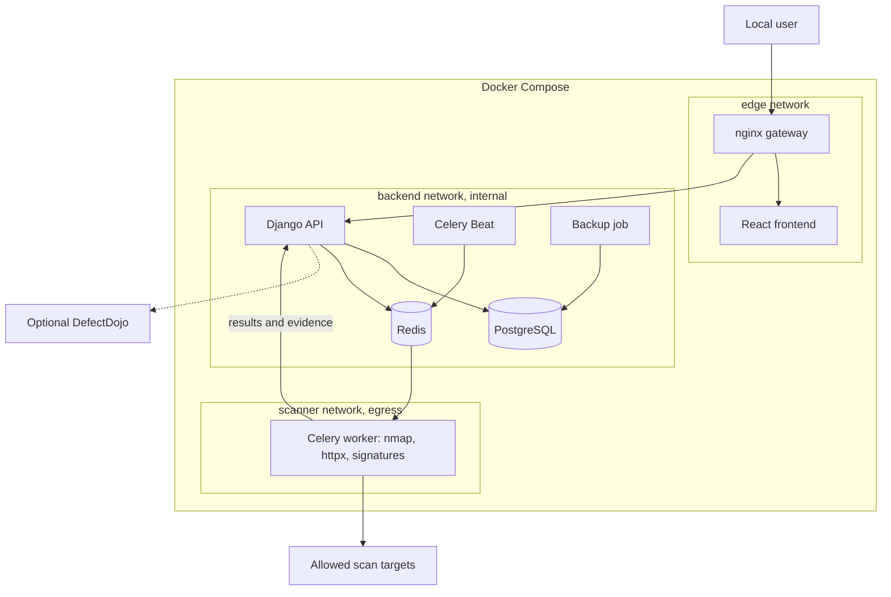

# Architecture

SurfaceX runs locally through Docker Compose. The same Linux images support `linux/amd64` and `linux/arm64` (including Docker Desktop on macOS and Windows with WSL2).

The management layer is separate from scan execution. The API never runs nmap directly, and workers have no administrative access to PostgreSQL or the container runtime.



## Components

**Gateway.** The only SurfaceX entry point exposed on the host (HTTP, port `8080`). It serves the frontend, proxies `/api/` and `/admin/` to the API, returns `404` for `/api/internal/`, and shows a maintenance page when the API is down. It does not terminate TLS: for shared deployments, terminate TLS on an external reverse proxy and set `SECURE_COOKIES=1` and `CSRF_PROTECT=1`. Besides the gateway, only the optional DefectDojo nginx (`8081`) and `lab-target` (`18088`) publish host ports.

**Frontend.** React/TypeScript UI: dashboard, targets, groups and schedules, scan configuration, findings and diffs, overrides, users, allowlist. English and Polish, dark and high-contrast modes.

**API.** Django REST Framework. Handles authentication and RBAC, input validation, targets, groups and schedules, passive lookups (crt.sh/RDAP), manual overrides, ingestion of worker results, observation diffing, CSV/JSON export, DefectDojo integration and the audit log. It is the only component that writes worker results to PostgreSQL.

**Scheduler.** Celery Beat publishes two periodic tasks to the `scan` queue, both every 60 s: `scans.reconcile_batches` (recovers orphaned batches, pauses runs past their window) and `scans.dispatch_schedules` (starts due group schedules). Workers run them by calling internal API endpoints; the logic itself runs in the API.

**Redis.** Celery queue and results, application cache (pending MFA tokens, passive lookup results) and the broker epoch ID. Sessions live in PostgreSQL. Redis runs without persistence and is not a source of truth. The API stores the broker epoch in PostgreSQL. If the epoch changes (Redis lost its data), all active batches are republished. Otherwise only `running` batches with no update for 10 minutes are recovered. Each republish assigns a new `delivery_id`, so stale copies of a task cannot write results. Tunable with `SCAN_RECONCILE_INTERVAL_SECONDS`, `SCAN_RECONCILE_STALE_SECONDS` and `SCAN_RECONCILE_BATCH_LIMIT`.

**Worker.** Celery worker that runs nmap discovery, port and service identification, batched httpx probing, TLS analysis, custom signatures, evidence normalization and confidence scoring. It holds only a token to fetch jobs and submit results. Results go back over the internal HTTP API, never by direct database writes.

```text
nmap → HTTP(S) endpoints → httpx JSONL → signatures → evidence → confidence score
```

On a compatible Linux host the worker uses SYN scan. Without raw sockets (e.g. Docker Desktop) it falls back to TCP connect. The mode is stored with each result. httpx output is processed as a stream; tool versions, options and limits are stored in run metadata. Detected technologies are inputs to the shared confidence model, not unconditional results.

**PostgreSQL.** Configuration, run snapshots, observations, evidence, overrides, history, users, roles and the audit log. Sensitive fields are encrypted by the application with AES-256-GCM.

**Backup.** A separate Compose job creates encrypted PostgreSQL dumps. See [operations.md](operations.md).

**DefectDojo (optional).** The `defectdojo` profile runs a pinned DefectDojo with its own nginx, uWSGI, Celery worker, Celery Beat, PostgreSQL and Valkey. SurfaceX pushes completed observations through `reimport-scan` as `Generic Findings Import`. DefectDojo is not required to run SurfaceX.

## Networks

| Network | Purpose |
|---|---|
| `edge` | gateway and frontend |
| `backend` | `internal`; API, scheduler, Redis, PostgreSQL, backup job. The gateway and worker also attach to it. PostgreSQL and Redis are not published on the host. |
| `scanner` | `172.30.0.0/24` with egress to scanned targets. Only the worker and `lab-target` (`172.30.0.10`) are attached. |
| `defectdojo` | internal network for DefectDojo components. Only its nginx bridges to `edge` and the SurfaceX API. |

## Scan flow

1. An operator adds targets and configuration.
2. The API validates them and stores them in PostgreSQL.
3. A run snapshot and batches are created and published to Redis.
4. A worker claims a batch and re-validates the target against the allowlist.
5. The worker runs nmap, passes discovered HTTP(S) endpoints to httpx, and applies signatures.
6. Results and evidence are sent to the internal API.
7. The API normalizes them and encrypts sensitive data.
8. The diff engine compares observations with the previous full run.
9. The dashboard shows results, lifecycle state and confidence.

## Security separation

- The gateway is the only SurfaceX service exposed on the host.
- PostgreSQL and Redis are reachable only on internal networks.
- The worker is the only component with scanning egress, and the only one that may get `NET_RAW`.
- `NET_ADMIN` is disabled; `network_mode: host` is not used.
- No service mounts the Docker socket.
- Containers use `no-new-privileges`, process limits and read-only filesystems where possible.
- Secrets are mounted from local `0600` files.

## Multi-architecture builds

```bash
docker buildx bake
```

Builds `linux/amd64` and `linux/arm64` images (`docker-bake.hcl`). httpx is built from source at a pinned version for the target architecture; nmap comes from the base image's package repository.

## Design decision: httpx instead of WhatWeb

httpx (ProjectDiscovery) is the primary HTTP fingerprinting tool: it handles large batches, is a single static binary that builds for both architectures, emits JSONL that is easy to stream, and fits shared rate limits and scan deadlines. WhatWeb has richer plugins but needs a Ruby runtime, costs more per run, can issue extra requests in aggressive modes, and its plugins are executable code, so they cannot serve as a user-authored signature format. WhatWeb could be added later as an optional, disabled-by-default second stage for hand-picked endpoints, with its own traffic limit and pinned plugins.

## Limitations

- No high availability: Compose on one host, single Redis and PostgreSQL instances.
- Docker Desktop networking differs from native Linux, so the worker uses TCP connect scan there.
- Windows is supported only through Docker Desktop with WSL2 and Linux containers.
